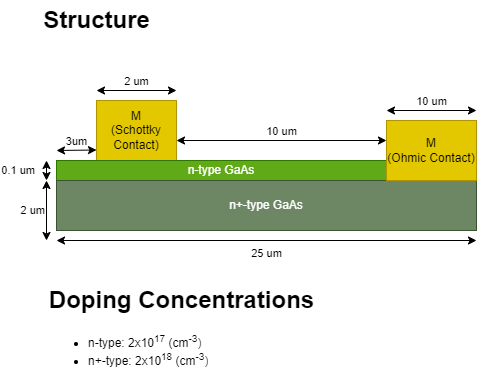
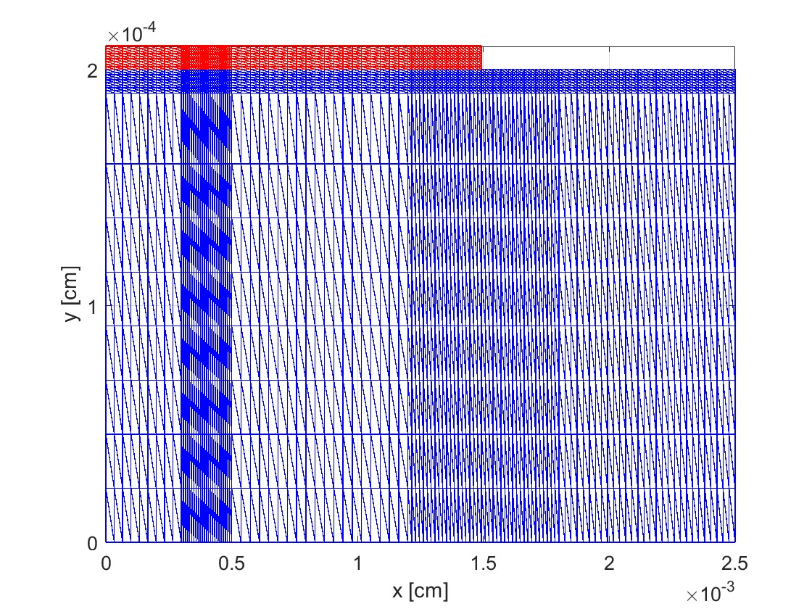
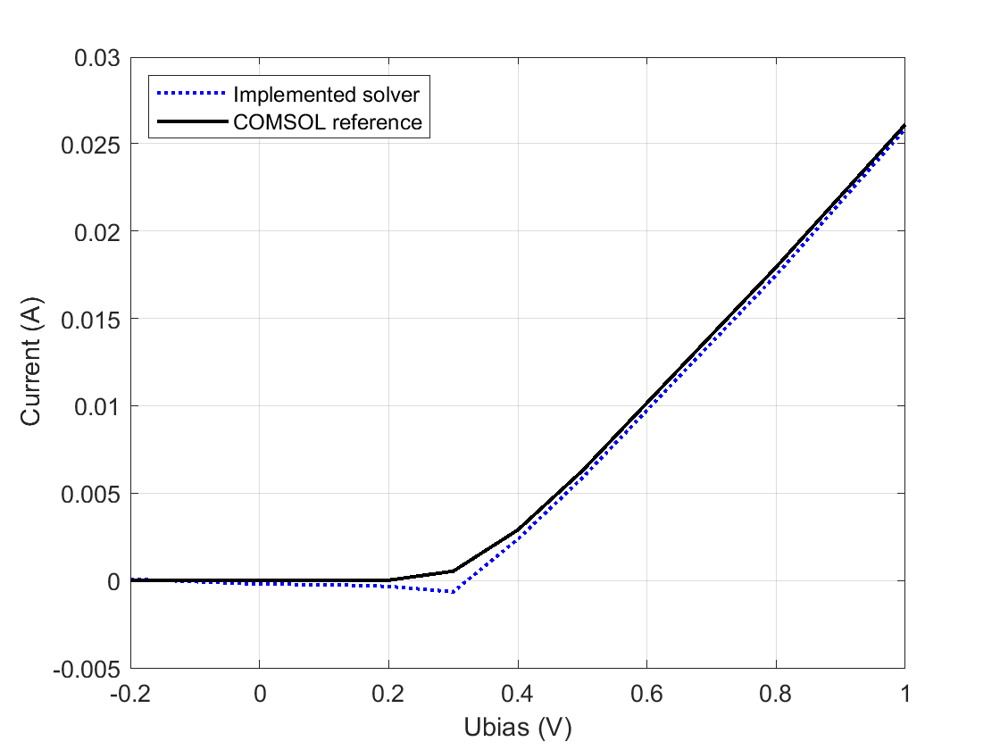

# 2D GaAs Drift–Diffusion FEM Solver

Research-oriented MATLAB implementation of a two-dimensional semiconductor device solver for layered GaAs n+/n structures. The code assembles the finite-element equations directly, advances the carrier equations in time, and compares the resulting fields and currents with COMSOL reference data.

<p align="center">
  
</p>

## Highlights

- Coupled Poisson and electron/hole continuity equations
- Linear triangular finite elements assembled from first principles
- Backward-Euler time integration with relaxed Gummel iteration
- Ohmic and Schottky contact models
- Non-uniform mesh refinement around the contact and material interface
- Field, carrier-density, cutline, and current-density visualization
- Validation data and models from COMSOL Multiphysics

## Representative results

| Finite-element mesh | Schottky-contact I–V validation |
|:---:|:---:|
|  |  |

The committed plots and CSV files are intended as reproducible reference outputs. Full field comparisons for the sampled bias points are collected in [`results/comparisons/`](results/comparisons/).

## Model at a glance

The simulated cross-section contains a 25 μm × 2 μm n+ GaAs layer and a 15 μm × 0.1 μm n-type GaAs layer. The default setup places a 2 μm Schottky contact on the upper surface and an Ohmic contact on the right. Physical parameters, doping, mobilities, and lifetimes are defined in [`src/Semiconductor_parameters.m`](src/Semiconductor_parameters.m); geometry and mesh controls are defined in [`src/geometry_mesh_new.m`](src/geometry_mesh_new.m).

The implementation uses normalized variables internally and converts the converged solution back to physical units for plotting and current extraction. Numerical details and derivations are available in the [semester thesis](docs/Semester_Thesis.pdf).

## Repository layout

```text
.
├── run_simulation.m           # one-command entry point for the full solver
├── plot_saved_results.m       # quick preview using committed CSV data
├── src/                       # FEM assembly, physics, contacts, and time stepping
├── visualization/             # plotting, cutline, comparison, and sweep tools
├── results/
│   ├── comparisons/           # field comparisons across biases and cutlines
│   ├── *.csv                  # processed voltage-sweep data
│   └── *.png                  # selected validation figures
├── figures/                   # device geometry and mesh illustrations
├── comsol_reference/          # COMSOL models and exported benchmark data
└── docs/                      # thesis and public-release checklist
```

## Requirements

- MATLAB R2020a or newer is recommended.
- No MATLAB add-on toolbox is required by the core solver.
- COMSOL Multiphysics is optional and is needed only to open or regenerate the `.mph` reference models.
- Python is optional. The two helper scripts in `visualization/` use NumPy and Matplotlib; install them with `python -m pip install -r requirements.txt`.

## Quick start

Clone the repository, open MATLAB in the repository root, and preview the committed voltage-sweep result:

```matlab
plot_saved_results
```

Run the complete default transient simulation with:

```matlab
run_simulation
```

The full simulation performs iterative nonlinear solves and is substantially slower than the saved-results preview. Its main configuration switches are near the top of [`src/fem_2d_Semiconductor_Transient_Analysis_Ver_2.m`](src/fem_2d_Semiconductor_Transient_Analysis_Ver_2.m), including plot generation, contact type, applied bias, time step, and maximum step count.

To run a voltage sweep, add the repository to the MATLAB path and use [`visualization/sweep_steady_current.m`](visualization/sweep_steady_current.m). The script defaults to load-only mode so it can plot the committed CSV without recomputing the sweep; set `load_only = false` inside the script to recompute it.

## Validation and data conventions

- `SO` denotes a Schottky–Ohmic contact configuration.
- `OO` denotes an Ohmic–Ohmic contact configuration.
- Lengths are expressed in centimetres inside the solver and shown in micrometres where appropriate in plots.
- Carrier concentrations are stored in cm⁻³ and current densities in A/cm² after conversion to physical units.
- COMSOL exports are stored under `comsol_reference/`; comparison utilities resolve this directory relative to the repository root.

## Scope

This is thesis research code rather than a production device simulator. The committed parameter set and reference results document the investigated GaAs structure; users should perform their own convergence studies and physical validation before applying the solver to other devices.

## Citation and license

If you use this work academically, please cite the thesis in [`docs/Semester_Thesis.pdf`](docs/Semester_Thesis.pdf). A software license has not yet been assigned, so the repository should not be treated as granting reuse or redistribution rights. See the [public-release checklist](docs/PUBLIC_RELEASE_CHECKLIST.md) before publishing a mirror.
